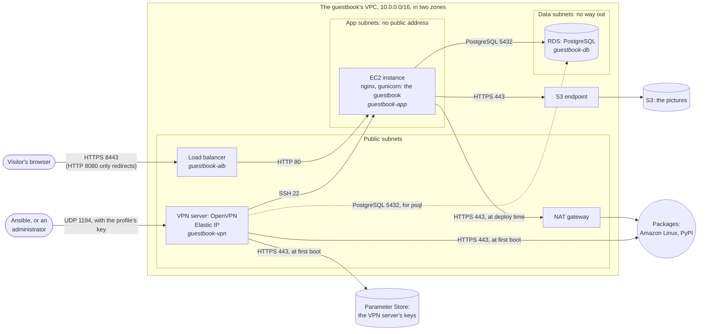
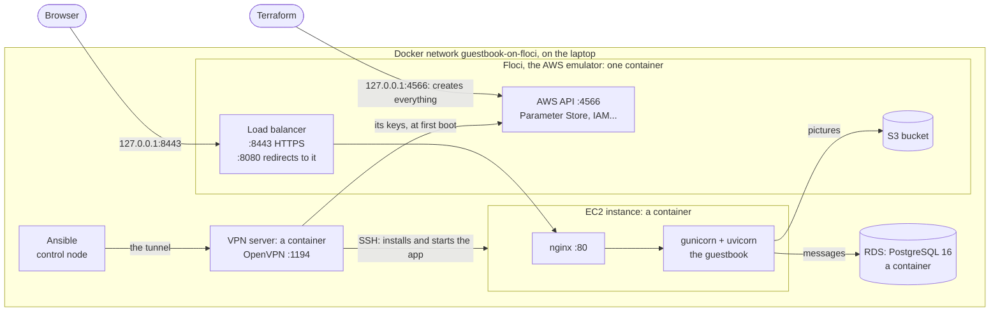
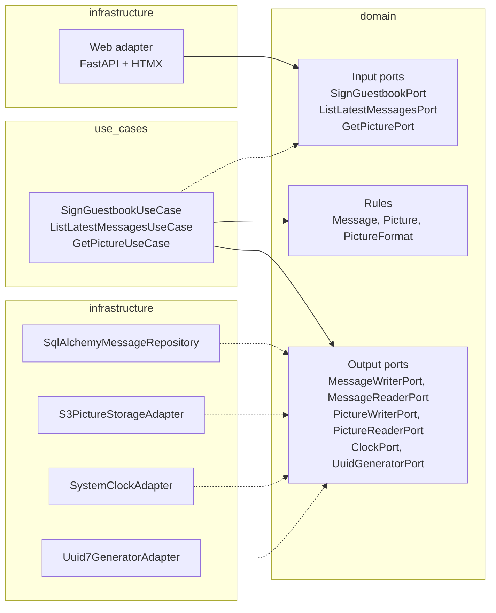

# guestbook-on-floci: deploying an app into an AWS emulator, on a laptop

## 1. What this is

A proof of concept: a small web app deployed to "AWS" without an AWS account.
[Floci](https://github.com/floci-io/floci) is an AWS emulator that runs in one Docker container
and answers the AWS API on `127.0.0.1`. Everything here runs on one laptop.

The tools are split the way they are on a real site:

| Tool | Does |
|---|---|
| **Terraform** | Creates the infrastructure in the emulator: a network of its own, an EC2 instance, a PostgreSQL RDS instance, an S3 bucket, an IAM role for the instance, a load balancer with HTTP and HTTPS listeners, and an OpenVPN server for the administrators |
| **Ansible** | Connects through the VPN, then over SSH to the instance: installs Python 3.14, nginx and supervisord, makes a release from the app's build (with uv) and runs it |
| **The app** | A guestbook, made with FastAPI and HTMX: visitors leave a message, with a picture if they like. Messages go to PostgreSQL, pictures to S3 |

### The network, as Terraform declares it



Each box in italics is a security group, and each arrow is a rule of one
(`terraform/security-groups.tf`). An arrow that isn't there is traffic no rule lets
through. Only the two arrows from the left come from the internet:

- **Visitors** reach the load balancer only. It forwards HTTP to nginx on the instance, and
  nginx to gunicorn. The instance has no public address, so nobody reaches it directly.
- **Administrators** reach the VPN server only. A packet without the profile's `tls-crypt`
  key gets no answer, so to anyone else the port looks closed. Through the tunnel, the VPN
  server lets them reach the instance by SSH, which is how Ansible deploys, and the database
  with `psql`.
- **The instance** talks to RDS, and to S3 through the VPC's endpoint: its role may use the
  bucket only that way. It goes out through the NAT gateway for its packages, which lets
  nothing in.
- **RDS** answers the instance and the VPN server, and sends nothing out.
- **The VPN server** downloads OpenVPN and fetches its two secret keys from Parameter Store at
  first boot. Its role may read those two keys and nothing else.

| Subnets | Hold | Their route out |
|---|---|---|
| Public | The load balancer, the NAT gateway, the VPN server | The internet gateway |
| App | The instance | The NAT gateway; S3 through the endpoint |
| Data | RDS | None |

### What runs on the laptop



Floci turns each instance and the database into a container of its own, and puts them all,
with itself, on one Docker network. The VPC, its subnets and its security groups exist only
as records in the emulator: every container here can reach every other one, and the
internet. So in the emulator:

- **The deploy goes through the VPN because it is told to.** The Ansible container could
  reach the instance directly. Its VPN profile routes the instance's address into the
  tunnel, and the deploy stops unless that route holds (`ansible/run-playbook.sh`).
- **The rules are checked by a test, not by traffic.** `terraform test`
  (`terraform/tests/`) checks each arrow of the first diagram, and that nothing else is let
  in, without the emulator.
- **Only the laptop reaches the stack.** Every port Floci publishes is bound to `127.0.0.1`,
  except each instance's SSH ([section 7](#7-safety-notes)).

What it proves: the same Terraform resources and the same playbook one would write for AWS
work against the emulator, end to end, and the app can be tested against real PostgreSQL and
S3 protocols with no cloud cost. What it does not prove is in [section 6](#6-limits).

## 2. Requirements

On Windows 11. Install with [Chocolatey](https://chocolatey.org/install), in a PowerShell window
opened as administrator:

```powershell
choco install docker-desktop terraform git
```

- **Docker Desktop, running,** with its default engine (WSL 2, Linux containers).
- **Terraform 1.9 or later.** Tried with 1.17.2. New to it? See [docs/terraform.md](docs/terraform.md).
- **Five free ports on `127.0.0.1`:** 4566 (the AWS API), 8080 and 8443 (the load balancer),
  7001 (PostgreSQL) and 4500 (Floci's web console).
- **Internet,** for the Docker images, the Terraform providers and the packages Ansible
  installs on the instance.
- Ansible itself needs no installing: it runs in a container.
- **[uv](https://docs.astral.sh/uv/getting-started/installation/),** to build the app. Tried with 0.13.7.
- Only for the app's tests and the `make` commands: Make (`choco install make`).

## 3. Step by step

The commands are the same in PowerShell and in Git Bash.

1. **Clone the repository.**

   ```powershell
   git clone https://github.com/CesarBallardini/guestbook-on-floci.git
   cd guestbook-on-floci
   ```

2. **Start the emulator** and wait until it is healthy. The first time, this downloads the
   Floci image (about 400 MB).

   ```powershell
   docker compose up -d --wait
   ```

3. **Create the infrastructure.** Terraform shows its plan and asks; answer `yes`. It takes
   about two minutes, most of it on the database. The VPN server then sets itself up on its
   own, at first boot, for a few more minutes: it installs OpenVPN and fetches its keys from
   Parameter Store.

   ```powershell
   cd terraform
   terraform init
   terraform apply
   cd ..
   ```

4. **Build the app.** The build is one wheel and `requirements.txt`, the locked dependencies
   with their hashes, both in `app/dist/`.

   ```powershell
   cd app
   uv build --wheel --out-dir dist
   uv export --frozen --no-dev --no-emit-project --format requirements-txt --output-file dist/requirements.txt
   cd ..
   ```

5. **Deploy the app.** Ansible connects to the VPN, then makes a release from the build and
   runs it. The first run builds the Ansible image and takes a few minutes; `--build` keeps
   the image in step with `ansible/` afterwards.

   ```powershell
   docker compose run --rm --build ansible
   ```

   It starts with `Through the VPN: <the instance's address> and the VPN server`. Right after
   step 3 it may first say `Waiting for the VPN`, for up to a few minutes, while the VPN
   server sets itself up. The run ends with `failed=0`. Among its lines it prints the instance's release, for example
   `Amazon Linux release 2023.12.20261120 (Amazon Linux), Python 3.14.10`, and its last line
   names the release that runs and the state of the database's schema, for example
   `Release 20261119T231500Z runs. The database's schema is up to date.`

6. **Open the guestbook** at one of the URLs below.

To deploy a change to the app, run steps 4 and 5 again: Ansible makes a new release, runs the
database migrations and restarts gunicorn on it. With the same build and the same config it
makes none and reports `changed=0`.

A release is a folder on the instance, `/opt/guestbook/releases/<UTC time>`, holding the
build, its virtual environment and the config; `/opt/guestbook/current` points at the one
that runs. The instance keeps the last five. To run the release before the current one:

```powershell
docker compose run --rm --build ansible -e rollback=true
```

A rollback leaves the database's schema as it is: it runs no migration, and undoes none.
The older release runs on the newer schema, and the playbook ends with
`The database's schema is ahead of it`. That works because every migration must suit the
releases before it (expand and contract, `docs/guestbook.md`). `make rollback-check`
proves it on the running stack.

### Administrators: the VPN

Nobody reaches the instance or the database from the internet: an administrator connects to
the VPN first, with a profile Terraform writes, one per name in the variable `vpn_clients`.
`ansible` is always one of them; it is the deploy's own.

```hcl
# terraform/terraform.tfvars, or -var on the command line
vpn_clients = ["ansible", "ana"]
```

After `terraform apply`, `.generated/vpn/ana.ovpn` holds everything the person needs: the
server's address, the VPN's certificate authority, their certificate and key, and the
`tls-crypt` key. On Windows, import it into OpenVPN Connect. Then `ssh` and `psql` reach the
VPC's private addresses.

- **To take someone out,** remove their name and apply, then deploy: the VPN server refuses
  them at their next connection. Certificates last 90 days, and `terraform apply` renews
  them in their last 30: the person imports the new profile.
- **In the emulator, a person's profile can't connect:** it names the Elastic IP, which
  Floci reports as `127.0.0.1`, and Floci doesn't publish the VPN's UDP port
  ([section 6](#6-limits)). Those profiles are for AWS. On the laptop, use `docker exec` as in
  [docs/floci.md](docs/floci.md), section 4, and `psql` on `127.0.0.1:7001`.
- **On AWS,** set `vpn_deploy_from_docker_network = false`, so the deploy's own profile is
  like a person's.

### The same, with Make

With Make installed (`choco install make`), the root `Makefile` wraps the usual commands.
`make help` lists them all.

| Command | Does |
|---|---|
| `make all` | Steps 2 to 5, then prints the URLs |
| `make up`, `make infra`, `make build`, `make deploy` | Step 2, step 3, step 4, steps 4 and 5 |
| `make rollback` | Runs the release before the current one |
| `make rollback-check` | Deploys, then a build with one more migration, rolls back across it and checks that the older release answers; restores the database and the release afterwards |
| `make urls`, `make status`, `make console` | The URLs, the running containers, the web console's URL |
| `make smoke` | Checks the running stack: the guestbook answers on both URLs and Terraform has nothing to change |
| `make idempotence` | Deploys, then runs the playbook again and fails unless that second run reports `changed=0` |
| `make replace-instance` | A new instance, with the app deployed on it |
| `make replace-vpn` | A new VPN server, which sets itself up at first boot, then a deploy through it |
| `make qa` | Every check: Terraform's (including `terraform test`, the network's rules), the playbook's (ansible-lint) and the app's |
| `make test`, `make test-integration`, `make test-e2e` | The app's tests, by kind |
| `make destroy` | Section 8 |

## 4. URLs

| What | URL | Notes |
|---|---|---|
| The guestbook, HTTPS | <https://localhost:8443/> | The browser warns once: see below |
| The guestbook, HTTP | <http://localhost:8080/> | Serves nothing: it sends the browser to the HTTPS address |
| Floci's web console | <http://127.0.0.1:4566/_floci/ui> | Shows the emulated resources. The first visit starts it and moves to <http://127.0.0.1:4500/> |
| Floci, the AWS API | `http://127.0.0.1:4566` | For Terraform and the AWS CLI, with any text as keys |
| PostgreSQL | `127.0.0.1`, port 7001, user `postgres`, database `guestbook` | Password: the Terraform variable `database_password` |

`terraform output` (in `terraform/`) prints the two guestbook URLs and a `psql` command line.
[docs/floci.md](docs/floci.md) shows how to look at the instance, the database, the bucket and
the load balancer, in the console and with the AWS CLI.

**About the certificate.** The emulator's Certificate Manager issues the HTTPS certificate, at
no cost, as ACM does on AWS. Its issuer is the emulator itself, which no browser knows, so the
browser shows a warning; choose "Advanced" and continue. The connection is encrypted all the
same. The answers carry an HSTS header, but a browser ignores it over a connection whose
certificate it does not trust, as here: it takes effect on AWS, with a certificate from a
known issuer.

## 5. The app and its tests

The app is in `app/`, laid out as ports and adapters:

| Folder | Holds | May import |
|---|---|---|
| `guestbook/domain/` | The rules for a message and its picture, and every port: `input_ports.py` and `output_ports.py` | The standard library only |
| `guestbook/use_cases/` | One class per use case; each implements one of the domain's input ports | The domain |
| `guestbook/infrastructure/` | The adapters: the database (SQLAlchemy repository, Alembic migrations), S3, the clock, the identifiers, and the web (FastAPI, templates, HTMX) | The domain |
| `application.py` | The composition root: the one file that puts all three together | All of them |

A solid arrow is a call; a dashed one says who implements a port.



`make architecture` checks that table on the imports, with
[import-linter](https://import-linter.readthedocs.io/) contracts written in `app/pyproject.toml`:

| Contract | Fails when |
|---|---|
| Dependencies point inwards | The domain imports a use case or an adapter, a use case imports an adapter, or an adapter imports a use case |
| No framework outside the infrastructure | The domain or a use case imports FastAPI, psycopg, boto3 and the like, directly or through another module |
| Adapters are independent | The PostgreSQL, S3 and web adapters import one another |
| Ports are independent | The input ports and the output ports import one another |

A unit test, `tests/unit/guestbook/test_architecture.py`, adds the rule a contract can't state: the
domain imports the standard library only.

How the pieces keep apart:

- **The repository** (`SqlAlchemyMessageRepository`) knows the database and the domain: it
  takes and returns `Message` objects. SQLAlchemy maps that domain class onto the table
  imperatively, in `guestbook/infrastructure/database/orm_mapping.py`, so there is no second
  class for a row and the domain imports nothing from SQLAlchemy.
- **The tables** are made by Alembic migrations, in
  `guestbook/infrastructure/database/migrations/`. On each deploy the playbook reads the
  schema's state as the new release sees it (`schema_version.py`: up to date, behind or
  ahead), and runs `alembic upgrade head` when it is behind, before it starts the app. A
  worker that starts on a schema behind its release refuses to start.
- **Time and identifiers** come through ports too (`ClockPort`, `UuidGeneratorPort`), so the
  tests hand over a fixed clock and counting identifiers instead of patching anything. The
  real identifiers are version 7 UUIDs.
- **Picture formats** are one table, `PICTURE_FORMATS` in `guestbook/domain/picture.py`.
  Accepting another format is one more row.
- **A storage that fails** reaches the web as one domain error, `StorageError`, whatever the
  adapter, and the visitor gets a 503.

The folders under `tests/unit/`, `tests/integration/` and `tests/e2e/` mirror the app's:
the tests for `guestbook/use_cases/sign_guestbook.py` are in
`tests/unit/guestbook/use_cases/test_sign_guestbook.py`. `tests/acceptance/` is by feature,
and `tests/fakes.py` holds the in-memory stand-ins for the output ports. `tests/contracts.py`
holds the tests that a fake and the adapter it stands for must both pass: the unit tests run
them on the fake, the integration tests on the real adapter.

From `app/`, with uv and Make:

```powershell
make install             # the environment, from the committed uv.lock
make test                # unit and acceptance (BDD) tests: nothing needs to be running
make test-integration    # the PostgreSQL and S3 adapters, against the emulator (after step 3)
make test-e2e            # a real browser against the deployed guestbook (after step 5)
make architecture        # the ports-and-adapters rules, on the imports
make qa                  # lint, both type checkers, architecture, tests with coverage, security scans
```

`make test-e2e` needs a browser for Playwright, once: `uv run --frozen playwright install chromium`.

| Kind | Where | What it checks | Needs |
|---|---|---|---|
| Unit | `tests/unit/` | The rules (by example and by property, with Hypothesis), the use cases, the web adapter (the token against forged posts included), the clock and identifier adapters, the fakes, and that `alembic.ini` finds the migrations by package | Nothing |
| Acceptance | `tests/acceptance/` | A visitor's scenarios, written in Gherkin | Nothing |
| Integration | `tests/integration/` | The repository (also under concurrent writers and with the database unreachable), the migrations, the schema's state (up to date, behind, ahead) and the S3 adapter, each test in a database or bucket of its own; and the composition root, `application.py`, which puts the real adapters together; and the build: the wheel holds every file of the package and nothing else | The emulator and the RDS instance (the build tests need only uv) |
| End to end | `tests/e2e/` | A real browser through the load balancer: signing with a picture, refusals, uploads over the app's and nginx's limits, no JavaScript, the redirect from plain HTTP and the HTTPS-only rule, a network that fails, a flood of posts | Everything deployed |

### What protects the guestbook

The guestbook has no accounts: anybody may sign. These keep that from being abused.

| Against | What | Where |
|---|---|---|
| A page of another site posting in a visitor's name | A random token, given in a cookie and in the form; a post needs both, equal. Answer: 403 | `guestbook/infrastructure/web/csrf.py` |
| Somebody listening on the network | HTTPS only: plain HTTP answers 301 to HTTPS, every answer tells the browser to use HTTPS only for a year (HSTS), and the token's cookie is `Secure` with the `__Host-` prefix | `terraform/main.tf` (the HTTP listener), `nginx.conf.j2`, `csrf.py` |
| A flood of posts | One address may sign twice a second on average, 20 at once. Answer: 429. Reading is not limited | `ansible/templates/nginx.conf.j2`, `signing_rate` and `signing_burst` in the playbook |
| Uploads that are too big | 2 MB for a picture (the app), 3 MB for a request (nginx). Answer: 400 or 413, same sentence | `guestbook/domain/picture.py`, `nginx.conf.j2` |
| Files that are not pictures | The bytes decide the format, never the file's name or what the browser says | `guestbook/domain/picture.py` |
| A database or an S3 that does not answer | Time limits of 5 and 3 seconds to connect; the visitor reads that the guestbook is not available, and the cause goes to the log | `database/engine.py`, `s3_picture_storage_adapter.py` |

nginx knows a visitor's address because the load balancer passes it on, and believes it
only from the addresses in `load_balancer_cidr` (`terraform/variables.tf`). In the emulator
every visitor from this laptop has the same address, Docker's gateway, so the limit on
signing is shared by all of them.

### The twelve factors

The app meets the twelve factors of [The Twelve-Factor App](https://12factor.net/), one of
them with a note: supervisord, the process manager that runs gunicorn, is itself started by
the playbook, because the emulated instance has no init (VIII).
[docs/guestbook.md](docs/guestbook.md#3-the-twelve-factors) states the compliance factor by
factor, and explains ports and adapters, SOLID and the architecture, with diagrams.

## 6. Limits

- **The instance is a container, not a virtual machine.** It has no systemd, so supervisord
  is its process manager: it runs nginx and gunicorn and restarts them when they die. But
  nothing starts supervisord at boot. After the instance's container restarts, nothing runs
  in it, sshd included: replace it and deploy again.

  ```powershell
  cd terraform
  terraform apply -replace=aws_instance.app
  cd ..
  docker compose run --rm --build ansible
  ```

  The messages and pictures survive: they live in RDS and S3, not on the instance. The VPN
  server is the same: `make replace-vpn` makes a new one, which sets itself up again, with
  the same Elastic IP and the same keys.
- **Releases live on the instance.** A replaced instance starts with none, so there is
  nothing to roll back to until the second deploy. A rollback does not undo the database's
  migrations: the older release runs on the newer schema. It can only because each migration
  suits the releases before it, a rule `make rollback-check` tests once and code review
  keeps.
- **Floci keeps its state in memory.** Restarting its container, Docker Desktop or the laptop
  loses every emulated resource. Then destroy what is left and start again from step 2.
- **One setting is the emulator's, not AWS's.** The HTTP listener's redirect uses the path
  `#{path}`, because Floci keeps the leading `/` in it. On AWS, which removes that slash and
  refuses a path without one, it must be `/#{path}` (`terraform/main.tf` says so too).
- **Security groups and IAM policies are recorded, not enforced.** The role's policy is there
  to show the shape; the emulator would let the app do anything. Subnets, routes and gateways
  are recorded the same way (`docs/floci.md`, section 5). So the private network is a
  private network on AWS only. In the emulator every container shares one Docker network,
  and every instance has the internet. `terraform test` (in `terraform/tests/`) checks what
  the network lets through, without the emulator.
- **The emulator shows the VPN working, not that it is the only way in.** Ansible's
  container stays on the Docker network, where it could reach the instance directly. It goes
  through the tunnel because its profile routes the instance's address there, and the deploy
  stops unless it does. Floci publishes no UDP port for an instance, so only that container
  can use the VPN here; a person's profile is for AWS.
- **A stack made before the private network can't be updated to it:** the load balancer's
  target group has to move to the new VPC while its listener still uses it. Destroy it
  (section 8) and start again from step 2.
- **The versions are pinned:** Floci 2.5.0 by digest, and Amazon Linux 2023 as of November
  2026 (with Python 3.14.10) in `floci/image-catalog.yaml`. The playbook stops if the
  instance's Python is older than 3.14.10, the first Python 3.14 that stops trusting the
  compromised eMudhra certificates (the advisory of 2026-10-20). A unit test,
  `app/tests/unit/test_certificate_floors.py`, keeps every pin at or above that advisory's
  releases.

## 7. Safety notes

- **Floci gets the Docker socket,** because it starts the instance and the database as
  containers. That gives it control of the laptop's Docker. This is why its image is pinned by
  digest, and why the stack should be stopped when it isn't in use.
- **The instance's container runs privileged.** That is how Floci starts instances when
  security groups aren't enforced.
- **Two ports are open beyond this machine: each instance's SSH, on ports 2200 and 2201 of
  every network interface** (the app's instance, then the VPN server). Floci publishes them
  that way and has no setting for it. Only the key that Terraform generated (in
  `.generated/`, ignored by Git) can log in. Every other port is bound to `127.0.0.1`, the
  console's included. To close it, set `"ip": "127.0.0.1"` in Docker Desktop, under Settings,
  Docker Engine; that changes the default for every container on the laptop.
- **The web console has no login.** Whoever reaches port 4500 sees every
  emulated resource. It is bound to `127.0.0.1`; keep it that way.
- **The instance has internet,** because Ansible installs packages on it. It only ever sees
  emulated data.
- **The VPN's keys are in three places:** the Terraform state, `.generated/vpn/` (the
  profiles, ignored by Git) and, for the server's two, Parameter Store. They are never in the
  VPN server's user data, which anyone allowed to read the instance's attributes could read.
  The VPN's certificate authority is its own, trusted by nothing else.
- **The Ansible container gets `NET_ADMIN` and `/dev/net/tun`,** to open its tunnel.

## 8. Destroy

```powershell
cd terraform
terraform destroy
cd ..
docker compose down -v
docker volume rm floci-aws-ec2-volumes
```

In that order: `terraform destroy` removes the instance, the database with its data and
everything in the emulator, and takes about a minute and a half. The last command removes a
volume Floci leaves behind.

## 9. The files

| Path | Holds |
|---|---|
| `Makefile` | The usual commands, by name. `make help` lists them |
| `compose.yaml` | Floci and the Ansible control node |
| `floci/image-catalog.yaml` | Which Docker image stands for the instance's AMI |
| `terraform/` | The infrastructure. `main.tf` is the place to start reading; `network.tf`, `security-groups.tf` and `vpn.tf` are the network and the way in. `tests/` checks the network's rules |
| `ansible/` | The control node's image, the playbook, its templates and its files |
| `app/` | The guestbook, its tests and its tooling |
| `docs/guestbook.md` | The app explained: ports and adapters, SOLID, the twelve factors, and its architecture in diagrams |
| `docs/terraform.md` | A mini tutorial on Terraform, with this project as the example |
| `docs/floci.md` | How to see what runs in the emulator: the console, its URLs, the AWS CLI |
| `.generated/` | Written by Terraform: the SSH key and the inventory, for Ansible, and the VPN's profiles in `vpn/`. Ignored by Git |

## 10. References

- [Floci](https://github.com/floci-io/floci): the AWS emulator this project deploys into.
- [Terraform](https://developer.hashicorp.com/terraform/docs): the tool that creates the
  infrastructure, and its [AWS provider](https://registry.terraform.io/providers/hashicorp/aws/latest/docs).
- [Ansible](https://docs.ansible.com/): the tool that installs and starts the app.
- [The Twelve-Factor App](https://12factor.net/): the rules for apps that run as services,
  checked in [docs/guestbook.md](docs/guestbook.md#3-the-twelve-factors).
- [Hexagonal architecture](https://alistair.cockburn.us/hexagonal-architecture/), by Alistair
  Cockburn: the article that introduced ports and adapters, the shape of the app.
