# The guestbook

The guestbook is a very simple app: a page where anybody leaves a message, with a picture if
they like, and reads the messages of others. It is an example to give Terraform and Ansible something real to deploy into [Floci](https://github.com/floci-io/floci), the AWS emulator.

It is small on purpose, and still touches what a real app touches: a database (RDS), a file
store (S3), a load balancer, a role for credentials, a schema that changes, uploads, a web
page. So the deployment has every part worth exercising, and the app stays short enough to
read in one sitting.

Because it is an example, it is also written the way a larger app would be: ports and
adapters, the SOLID principles, the twelve factors. This document explains those three ideas
briefly, each with where the guestbook applies it, and then shows the architecture in
diagrams.

- [1. Ports and adapters](#1-ports-and-adapters)
- [2. SOLID](#2-solid)
- [3. The twelve factors](#3-the-twelve-factors)
- [4. Architecture](#4-architecture)

All paths below are under `app/`.

## 1. Ports and adapters

Also called hexagonal architecture. The idea, from Alistair Cockburn: the rules of the app
sit in the middle and know nothing of the outside. Everything outside (the web, the database,
the file store, even the clock) is reached through a **port**, which is an interface the
middle defines in its own words. An **adapter** is the code that connects one port to one
real technology.

There are two kinds of ports:

- An **input port** is what the outside may ask of the app: "sign the guestbook". Something
  outside calls it. Here the web calls it.
- An **output port** is what the app asks of the outside: "keep this message". Something
  outside implements it. Here the database adapter implements it.

What this buys:

- **The rules can be tested without anything running.** The tests hand the app in-memory
  implementations of the output ports, and run in seconds.
- **A technology can be replaced without touching the rules.** Moving the pictures from S3 to
  a folder on disk is one new adapter and one changed line where the app is put together.
- **The dependencies point one way.** The outside knows the middle; the middle never knows
  the outside.

In the guestbook:

| Part             | Folder                      | What it holds                                                | What it may import              |
| ---------------- | --------------------------- | ------------------------------------------------------------ | ------------------------------- |
| Domain           | `guestbook/domain/`         | The rules, and every port                                    | The standard library only       |
| Use cases        | `guestbook/use_cases/`      | One class per input port, written on top of the output ports | The domain                      |
| Infrastructure   | `guestbook/infrastructure/` | The adapters: web, database, S3, clock, identifiers          | The domain, never the use cases |
| Composition root | `application.py`            | The one place that makes the adapters and hands them over    | All of them                     |

These rules are checked, not only written down: `make architecture` runs import-linter
contracts that fail when an import crosses a line.

## 2. SOLID

Five principles for code that stays easy to change.

| Principle                 | What it asks                                                               | In the guestbook                                                                                                                                                  |
| ------------------------- | -------------------------------------------------------------------------- | ----------------------------------------------------------------------------------------------------------------------------------------------------------------- |
| **S**ingle responsibility | A class has one reason to change                                           | One use case per class. The rules for messages and for pictures are in separate modules. The repository only stores and finds; it validates nothing               |
| **O**pen/closed           | Add behaviour by adding code, not by editing what works                    | A picture format is one row of `PICTURE_FORMATS` in `domain/picture.py`. Accepting another format is one more row                                                 |
| **L**iskov substitution   | Whatever implements an interface can stand in for any other implementation | The in-memory fakes and the real adapters pass the same tests, in `tests/contracts.py`. That is what makes the fakes trustworthy                                  |
| **I**nterface segregation | Nobody depends on methods they do not use                                  | The output ports are split by need: `MessageReaderPort` and `MessageWriterPort`, likewise for pictures.                                                           |
| **D**ependency inversion  | The rules depend on interfaces, and the details depend on them too         | The use cases receive ports in their constructors. The domain defines the ports; the infrastructure implements them. Even the clock and the identifiers are ports |

## 3. The twelve factors

[The Twelve-Factor App](https://12factor.net/) is a list of rules for apps that run as
services: easy to deploy, to move between environments and to scale. How the guestbook stands:

| Factor                 | What it asks                     | In the guestbook                                                                                                                                                       | Met         |
| ---------------------- | -------------------------------- | ---------------------------------------------------------------------------------------------------------------------------------------------------------------------- | ----------- |
| I. Codebase            | One codebase, many deploys       | One repository; each deploy is a copy of it                                                                                                                            | Yes         |
| II. Dependencies       | Declare and isolate them         | `pyproject.toml`, locked in `uv.lock`, installed into a virtual environment                                                                                            | Yes         |
| III. Config            | Keep it in the environment       | `DATABASE_URL`, `PICTURE_BUCKET`, `S3_ENDPOINT_URL`, `LOG_LEVEL`. None in the code                                                                                     | Yes         |
| IV. Backing services   | Treat them as attached resources | PostgreSQL and S3 are addresses in the config; another one is a change of config                                                                                       | Yes         |
| V. Build, release, run | Separate the three stages        | A wheel and the locked dependencies are built on the laptop; a release is that build plus the config, in its own folder on the instance; gunicorn runs the current one | Yes         |
| VI. Processes          | Stateless, sharing nothing       | Messages in PostgreSQL, pictures in S3, the form's token in the visitor's cookie. Nothing is kept in memory between requests                                           | Yes         |
| VII. Port binding      | The app serves by binding a port | gunicorn serves HTTP on its own port; nginx only routes to it                                                                                                          | Yes         |
| VIII. Concurrency      | Scale out with processes         | More gunicorn workers, or more instances. supervisord, the process manager, runs gunicorn in the foreground and restarts it; no daemon, no pid file                    | Yes         |
| IX. Disposability      | Start fast, stop gracefully      | Starts in seconds; on SIGTERM gunicorn finishes its requests and exits                                                                                                 | Yes         |
| X. Dev/prod parity     | Keep environments alike          | The same PostgreSQL 16 and S3 protocol in the emulator as on AWS; the same locked dependencies                                                                         | Yes         |
| XI. Logs               | Treat them as a stream of events | The app writes to standard output and never opens a log file. supervisord collects the stream and decides where it goes                                                | Yes         |
| XII. Admin processes   | Run them as one-off processes    | `alembic upgrade head` runs on the instance, from the same code, with the same config                                                                                  | Yes         |

### Compliance

**The guestbook meets the twelve factors.** One of them, VIII, carries a note that comes from
the emulator, not from the app:

- **VIII. Concurrency: met, with a note.** The factor asks that an app never turn itself into
  a daemon nor write a pid file: starting, watching and restarting processes belongs to the
  system's process manager. Here that is supervisord. It runs gunicorn in the foreground,
  restarts it when it dies and keeps what it writes; the same goes for nginx. The note: the
  emulated instance is a container whose first process is not an init, so nothing starts
  supervisord at boot. The playbook starts it, as the one daemon left, and after the
  instance's container restarts nothing runs until the instance is replaced. On a real
  instance systemd would start it, or run gunicorn itself from a unit.

Three changes were needed to get here.

For factor VIII, gunicorn lost `--daemon` and its pid file, and supervisord took over what
the playbook's shell scripts did. One setting came with it, in `ansible/files/gunicorn.conf.py`:
a worker dies with its master. Without it, a master killed outright leaves its workers
holding the port, and the master that supervisord starts next can never take it.

For factor V, the deploy has three stages, each with its own command and its own result:

| Stage   | Where        | What it makes                                                                                                                              |
| ------- | ------------ | ------------------------------------------------------------------------------------------------------------------------------------------ |
| Build   | The laptop   | `make build`: the app's wheel and `requirements.txt`, the locked dependencies with their hashes, in `app/dist/`. The same source gives the same bytes |
| Release | The instance | The playbook: the build installed in a virtual environment, with the config next to it, in `/opt/guestbook/releases/<UTC time>`. Nothing in it changes afterwards |
| Run     | The instance | supervisord runs gunicorn through the link `/opt/guestbook/current`, which points at one release                                           |

A release is named by the moment it was made, such as `20261119T231500Z`. The same build with
the same config is the same release, so deploying twice makes one. A new build or a new
config makes a new release, and `make rollback` points `current` back at the one before. One
limit remains: the dependencies are downloaded on the instance when a release is made (the
hashes in `requirements.txt` refuse anything that differs from the lock). Before, the
playbook copied the source to the instance and installed the dependencies there, in place.

A rollback moves the code back and leaves the database's schema where it is. The schema is
never rolled back: a `downgrade()` that drops a column drops what it held, and it would run
under pressure, untested. So a release must run on the schema of any later release, and every
migration follows **expand and contract**:

- One release may add: a table, a nullable column or one with a default, an index, a
  constraint the older code's rules already respect (as `0002` does).
- What removes or renames is split across releases: add the new column and write to both,
  then read from the new one, and drop the old one only when no release kept on the instance
  (the last five) still reads it.
- Every migration keeps its `downgrade()`, for development and the tests. A deploy or a
  rollback never runs it. On AWS, a disaster is answered with an RDS snapshot or a
  point-in-time recovery.

`guestbook/infrastructure/database/schema_version.py` compares the database's revision with
the release's latest migration, in one of three states:

| State        | Means                                                             | When a worker starts           | The playbook                                                    |
| ------------ | ----------------------------------------------------------------- | ------------------------------ | --------------------------------------------------------------- |
| `up-to-date` | The database is at the release's latest migration                 | Starts                         | Runs no migration                                               |
| `behind`     | The release's migrations have not all run                         | Refuses to start, and logs why | Runs `alembic upgrade head`; refuses a rollback to that release |
| `ahead`      | A revision the release does not know: a newer release migrated it | Starts, and logs a warning     | Runs no migration, and says so                                  |

A database that cannot be reached does not stop a worker from starting: the app answers each
request that needs it with a page that says so. Refusing would keep the app down after the
database is back, since supervisord gives up on a program that keeps failing. `ahead` cannot
be told apart from a revision of another branch; with one line of migrations (a unit test
holds that) it means a rollback. `make rollback-check` deploys a build with one more
migration, rolls back across it and checks that the older release answers.

A release is made from the wheel alone, so a file missing from the wheel is missing on the
instance. Two tests guard that: `tests/integration/test_build.py` builds a wheel and fails
unless it holds every file of the `guestbook` package and nothing but the app, and
`tests/unit/guestbook/infrastructure/database/test_migrations.py` checks that `alembic.ini`
finds the migrations by package, which is what lets the same file work from the wheel.

For factor XI, `application.py` sets up logging itself: every event goes to standard output,
from the level `LOG_LEVEL` names (`INFO` when not set). Before, the app had no logging of its
own and its failures were written nowhere.

## 4. Architecture

### 4.1 Actors and use cases

There is one kind of person, the **visitor**, and three things they do. Nobody logs in. The
database and the bucket take part in the use cases without starting any.

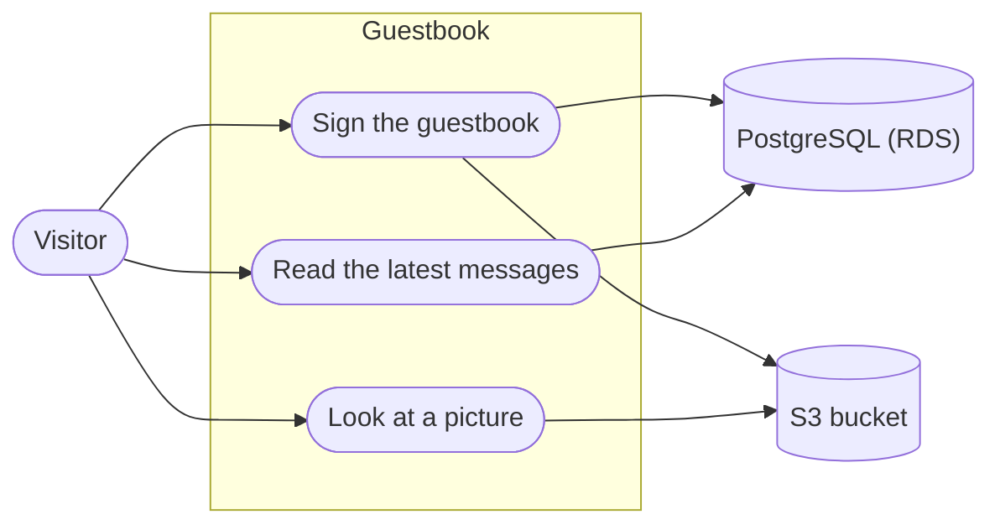

| Use case                 | What the visitor gets                 | Rules                                                                                                                        |
| ------------------------ | ------------------------------------- | ---------------------------------------------------------------------------------------------------------------------------- |
| Sign the guestbook       | Their message, at the top of the list | A name of 1 to 60 characters, a text of 1 to 500. A picture is optional: up to 2 MB, and PNG, JPEG, GIF or WebP by its bytes |
| Read the latest messages | The 50 newest messages, newest first  | None                                                                                                                         |
| Look at a picture        | The picture of a message              | Only a text with the shape of a key is ever looked up                                                                        |

Each use case is one input port in `domain/input_ports.py` and one class in `use_cases/`.

### 4.2 Class diagrams

#### The layers: the adapters

Who knows whom. The adapters know the domain's ports and nothing of the use cases: the web
calls the input ports, the others implement the output ports.

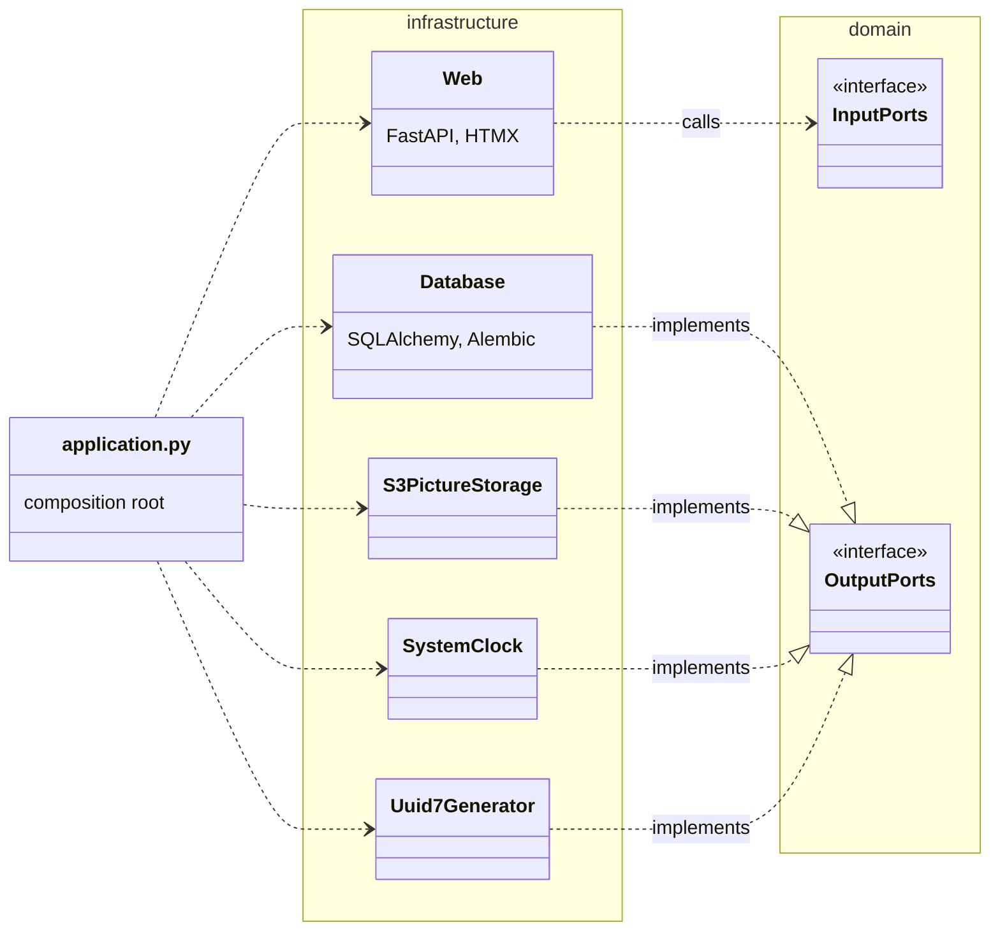

#### The layers: the use cases

The use cases know the domain only: they implement the input ports, call the output ports
and apply the rules.

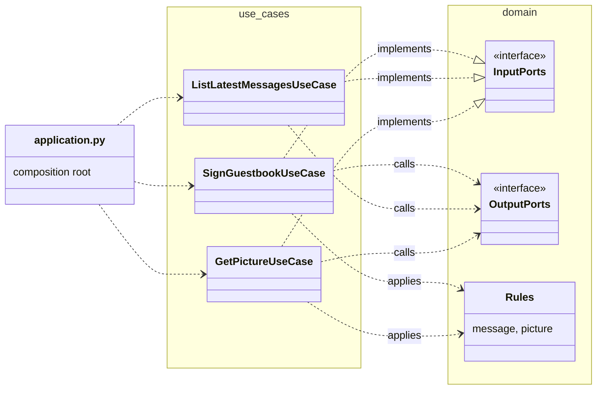

#### The domain's rules

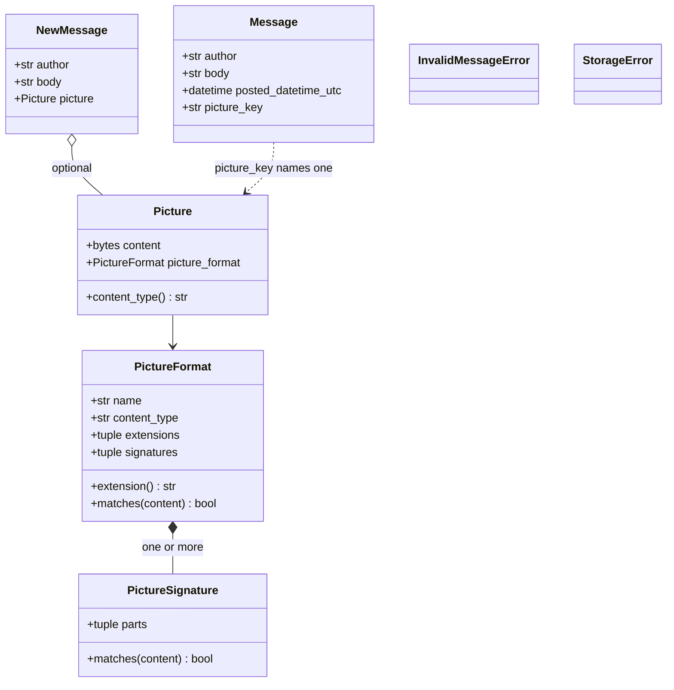

`NewMessage` is a message that passed the rules and is not posted yet; `new_message()` makes
it or raises `InvalidMessageError`. `Message` is a posted one. `StorageError` is what every
adapter turns its own failures into.

#### Input ports: the web calls them

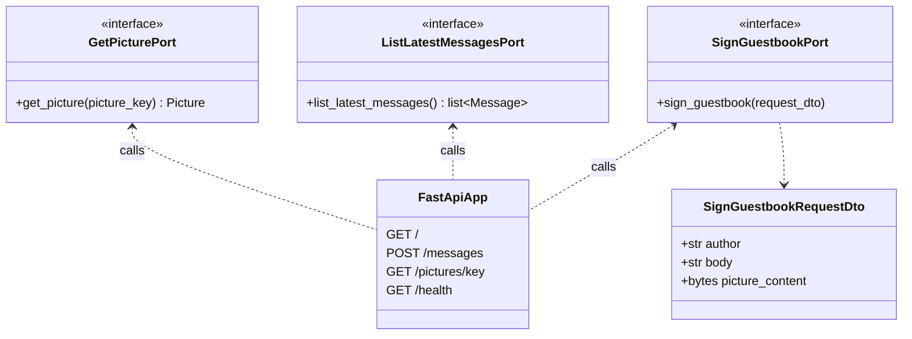

#### Input ports: the use cases implement them

Signing:

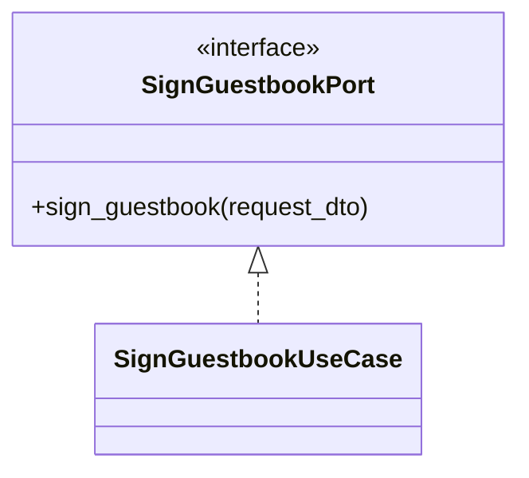

Reading the latest messages:

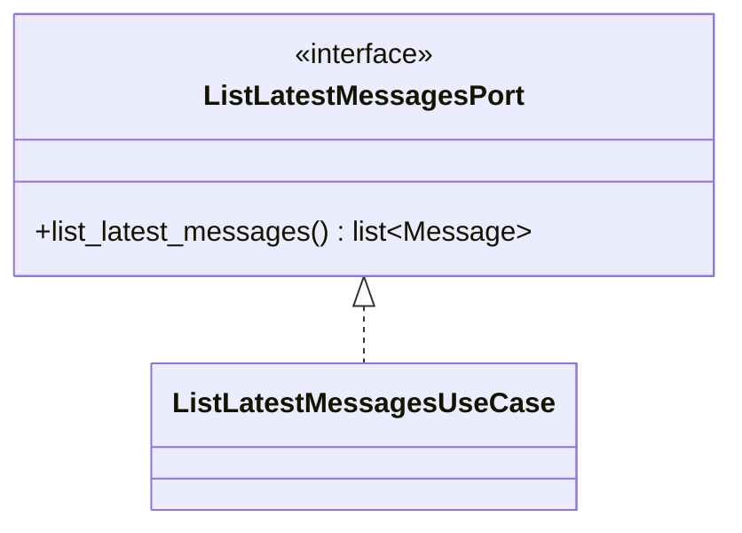

Looking at a picture:

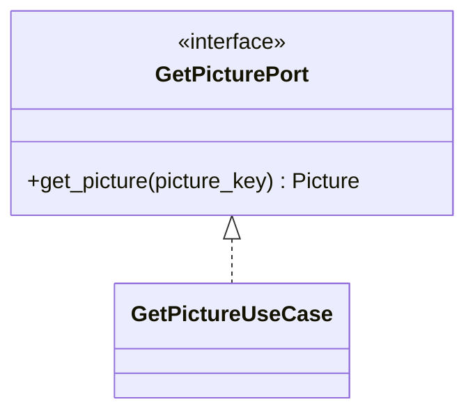

#### Output ports: the adapters implement them

The messages:

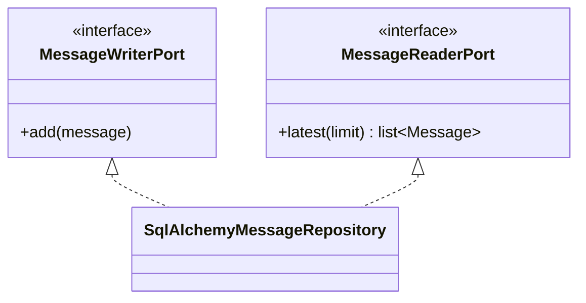

The pictures:

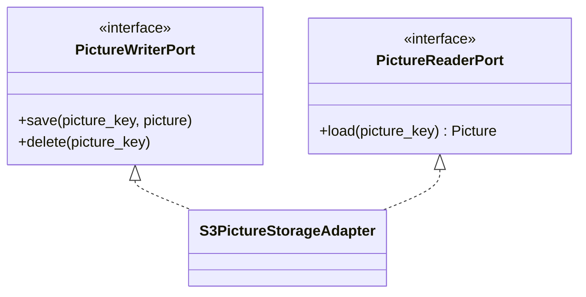

The clock:

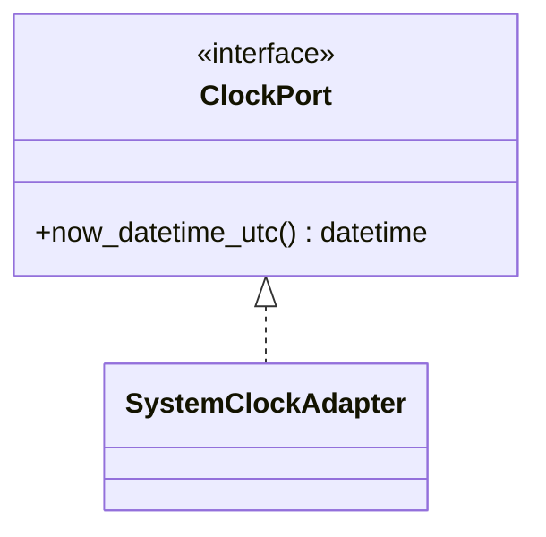

The identifiers:

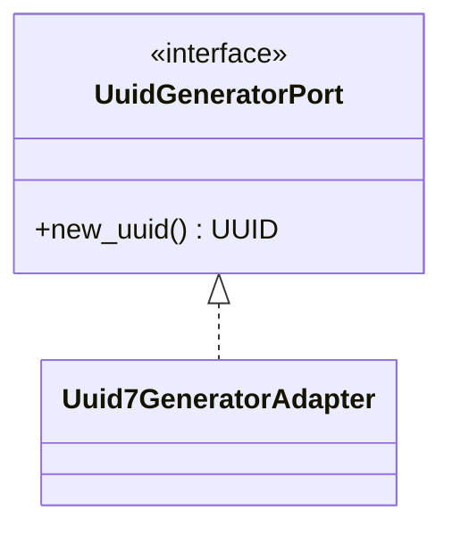

In the tests, `tests/fakes.py` holds a second implementation of each output port, kept in
memory: `InMemoryMessageRepository`, `InMemoryPictureStorageAdapter`, `FixedClockAdapter`
and `SequenceUuidGeneratorAdapter`.

#### Output ports: the use cases call them

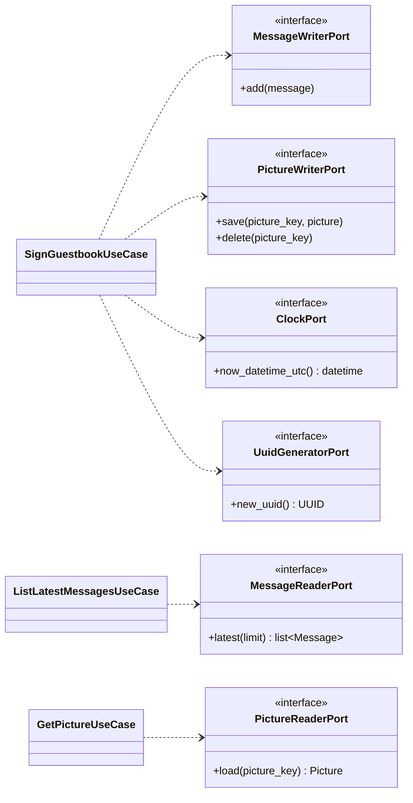

Each use case asks for the ports it needs and no more: only `SignGuestbookUseCase` writes.

### 4.3 Sequence diagrams

#### Sign the guestbook, with a picture

The picture is stored first, so a message never points at a picture that is not there.

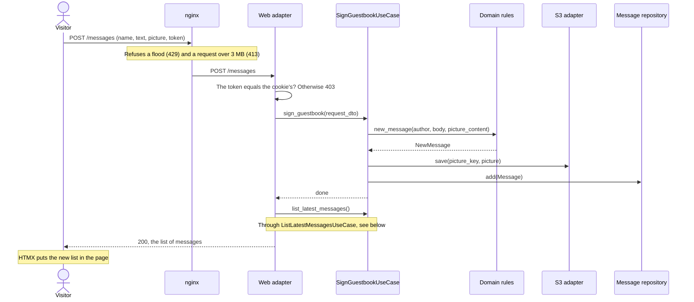

A browser without JavaScript posts the same form and gets a redirect (303) back to the page
instead of the list.

#### Sign the guestbook: what can go wrong

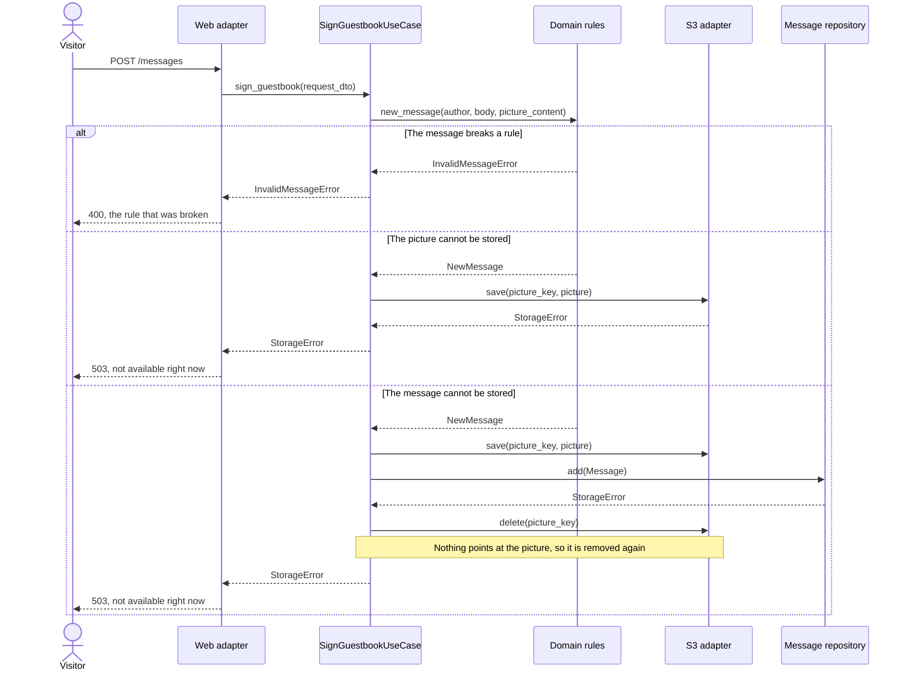

The web adapter writes the cause of every `StorageError` to the log; the visitor only reads
that the guestbook is not available.

#### Read the latest messages

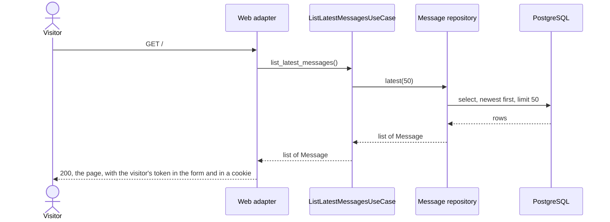

#### Look at a picture

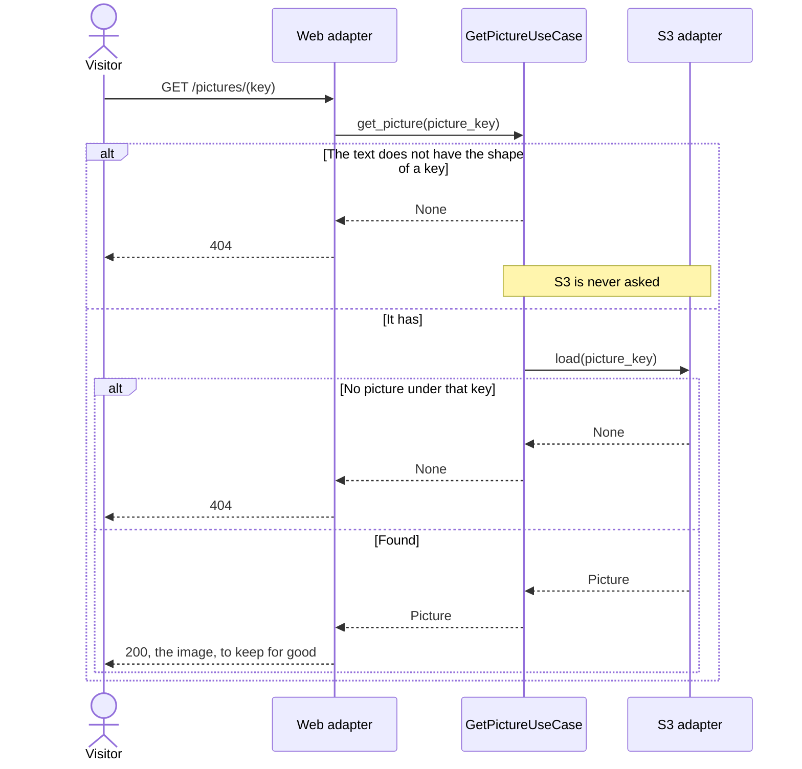

The picture's media type comes from its key's extension, not from what the bucket says about
the object.
