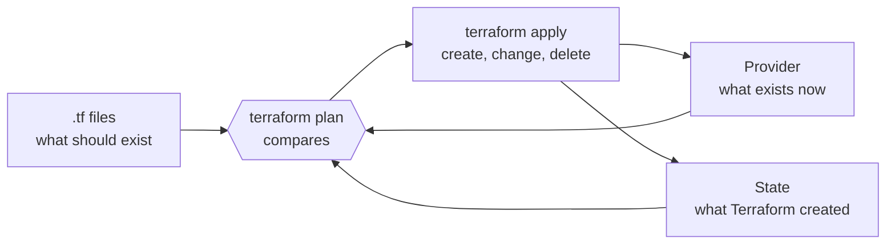

# Terraform: a mini tutorial

This page teaches enough Terraform to read and change the files in `terraform/`. Every command
here runs against Floci, the AWS emulator of this project, so nothing costs money and nothing
can break outside the laptop.

## 1. What Terraform is

[Terraform](https://developer.hashicorp.com/terraform) creates infrastructure from text files.
The files, with the extension `.tf`, describe what should exist: "one bucket with this name",
"one database of this size". They don't say how to create it.

Each time it runs, Terraform does three things:

1. It reads the `.tf` files: what should exist.
2. It reads its **state**, a file where it wrote down what it created before, and asks the
   provider (here, the emulator) whether that is still true.
3. It makes the calls that close the gap: create what is missing, change what differs, delete
   what is no longer described.



Running it twice in a row changes nothing the second time. That is the point: the files are
the truth, and Terraform makes reality match them.

## 2. Install

On Windows 11, in a PowerShell window opened as administrator, with
[Chocolatey](https://chocolatey.org/install):

```powershell
choco install terraform
choco install tflint      # optional: a linter
```

Then, in a new window:

```powershell
terraform version         # 1.9 or later
```

## 3. A first exercise: one bucket

The emulator must be running. From the repository's root:

```powershell
docker compose up -d --wait
```

Make an empty folder anywhere outside the repository, and in it a file named `main.tf`:

```hcl
terraform {
  required_providers {
    aws = {
      source  = "hashicorp/aws"
      version = "~> 6.0"
    }
  }
}

provider "aws" {
  region                      = "us-east-1"
  access_key                  = "test"
  secret_key                  = "test"
  skip_credentials_validation = true
  skip_metadata_api_check     = true
  skip_requesting_account_id  = true
  s3_use_path_style           = true

  endpoints {
    s3 = "http://127.0.0.1:4566"
  }
}

variable "bucket_name" {
  description = "The name of the bucket."
  type        = string
  default     = "first-steps"
}

resource "aws_s3_bucket" "first" {
  bucket = var.bucket_name
}

output "bucket_arn" {
  value = aws_s3_bucket.first.arn
}
```

The `provider` block is what points Terraform at the emulator instead of AWS: fake keys, three
checks skipped because there is no real account to check, and the address of the emulator for
S3. Section 5 explains the other blocks.

### 3.1 init

```powershell
terraform init
```

Run it once per folder. It downloads the providers the files name (here, the one for AWS) into
`.terraform/`, and writes `.terraform.lock.hcl` with the exact versions it chose.

### 3.2 plan

```powershell
terraform plan
```

It changes nothing. It shows what `apply` would do:

```
  # aws_s3_bucket.first will be created
  + resource "aws_s3_bucket" "first" {
      + bucket = "first-steps"
      ...
Plan: 1 to add, 0 to change, 0 to destroy.
```

### 3.3 apply

```powershell
terraform apply
```

It shows the same plan and asks. Type `yes`:

```
Apply complete! Resources: 1 added, 0 changed, 0 destroyed.

Outputs:

bucket_arn = "arn:aws:s3:::first-steps"
```

The bucket exists now, in the emulator. Run `terraform plan` again: "No changes."

### 3.4 Change it

Add a tag to the bucket in `main.tf`:

```hcl
resource "aws_s3_bucket" "first" {
  bucket = var.bucket_name

  tags = {
    Purpose = "tutorial"
  }
}
```

```powershell
terraform plan
```

```
  # aws_s3_bucket.first will be updated in-place
  ~ resource "aws_s3_bucket" "first" {
      ~ tags = {
          + "Purpose" = "tutorial"
        }
Plan: 0 to add, 1 to change, 0 to destroy.
```

Run `terraform apply` to make the change.

### 3.5 A change that replaces

Some properties can't be changed on a thing that exists. A bucket can't be renamed, so a new
name means a new bucket. Ask for a plan with another name, without touching the file:

```powershell
terraform plan -var bucket_name=second-steps
```

```
  # aws_s3_bucket.first must be replaced
      ~ bucket = "first-steps" -> "second-steps" # forces replacement
Plan: 1 to add, 0 to change, 1 to destroy.
```

Don't apply this one. It is here to show the most important habit: **read the plan before
answering `yes`**, and look for "must be replaced" and "destroy". On a database, a replacement
loses the data.

### 3.6 destroy

```powershell
terraform destroy
```

It shows what it would delete and asks. Type `yes`. The bucket is gone, and the folder can be
deleted.

## 4. Reading a plan

| Symbol | Means |
|---|---|
| `+` | Will be created |
| `~` | Will be changed in place |
| `-` | Will be destroyed |
| `-/+` | Will be destroyed and created again ("must be replaced") |
| `(known after apply)` | A value the provider decides, such as an id or an address |

The last line counts them: `Plan: 1 to add, 0 to change, 1 to destroy.`

## 5. The language, in seven blocks

**`terraform`** says which providers the files need and which versions are acceptable.
`~> 6.0` means "6.0 or later, below 7".

**`provider`** configures one of them: for AWS, the region, the keys, and here the emulator's
address.

**`resource`** describes one thing to create. It has a type, defined by the provider, and a
name, chosen by the author and used only inside these files:

```hcl
resource "aws_s3_bucket" "first" {     # type "aws_s3_bucket", name "first"
  bucket = "first-steps"               # the real name, in AWS
}
```

**`data`** looks up something that exists already and that Terraform doesn't manage. This
project asks for the default network instead of creating one:

```hcl
data "aws_vpc" "default" {
  default = true
}
```

**`variable`** is a setting with a type, a description and usually a default.
**`output`** is a value printed after `apply`, and again with `terraform output`.
**`locals`** names an expression, to write it once and use it several times.

### References

A block refers to another by `type.name.attribute`; data sources add `data.` in front,
variables are `var.name` and locals are `local.name`:

```hcl
resource "aws_lb_target_group_attachment" "app" {
  target_group_arn = aws_lb_target_group.app.arn
  target_id        = aws_instance.app.id
  port             = 80
}
```

References are also how Terraform finds the order of work. Nobody tells it that the instance
comes before its registration in the load balancer: it sees that one block needs a value of
the other. For the same reason, the order of blocks in a file, and the split into files, don't
matter: Terraform reads every `.tf` file of the folder as one.

## 6. State

`terraform.tfstate` is where Terraform records what it created: for each `resource` block,
the id of the real thing and its properties.

```powershell
terraform state list                        # every resource Terraform manages
terraform state show aws_instance.app       # one of them, in full
```

- **Don't edit it by hand, and don't delete it.** Without it, Terraform no longer knows that
  the things it created are its own, and would try to create them all again.
- **It holds secrets.** In this project: the database's password and the SSH private key. That
  is why `.gitignore` keeps it out of the repository. Teams that share real infrastructure keep
  the state in a shared, locked place (an S3 bucket, for instance) instead of on one laptop.
- **When the emulator lost everything.** Floci keeps its resources in memory, so restarting it
  empties it while the state still lists them. Here that is cheap to solve: run
  `terraform destroy`, which finds nothing left to delete, then `terraform apply`. On real
  infrastructure the state and reality drift apart only when somebody changes things by hand,
  and `terraform plan` shows it.

## 7. Variables

`terraform/variables.tf` lists this project's settings. There are three ways to give one a
value other than its default:

| How | Example | Lasts |
|---|---|---|
| On the command line | `terraform apply -var listener_port=9090` | That run. The next plain `apply` puts the default back |
| In a file named `*.auto.tfvars` | A line `listener_port = 9090` in `local.auto.tfvars` | Until the line is removed. Git ignores these files here: they are one laptop's choices |
| In the environment | `$env:TF_VAR_listener_port = "9090"` | That PowerShell window |

A variable marked `sensitive = true`, such as `database_password`, is hidden in plans and
outputs. It is still in the state, in clear.

## 8. Habits

```powershell
terraform fmt           # rewrites the files in the standard layout
terraform validate      # checks them without calling the provider
tflint                  # finds mistakes validate doesn't, such as unused variables
terraform plan          # before every apply, and read it
```

- **Commit `.terraform.lock.hcl`.** It makes everyone use the same provider versions. To move
  to newer ones, run `terraform init -upgrade` and commit the change.
- **Never commit** `.terraform/` or `terraform.tfstate*`.
- **To make one thing again,** name it: `terraform apply -replace=aws_instance.app` destroys
  and creates the instance and whatever depends on its id, and leaves the rest alone.

## 9. This project's files

| File | Holds | Look at it for |
|---|---|---|
| `versions.tf` | The `terraform` and `provider` blocks | How every AWS call is sent to the emulator |
| `variables.tf` | The settings | Descriptions that say what must match `compose.yaml` |
| `main.tf` | Every resource | `data` lookups, references, `jsonencode` for IAM policies, and files written with `local_sensitive_file` |
| `outputs.tf` | What `apply` prints | Outputs built from variables and resources |

Three things in `main.tf` go beyond the exercise above:

- **Three providers work together.** `tls_private_key` (provider `tls`) generates an SSH key,
  `aws_key_pair` gives its public half to the emulator, and `local_sensitive_file` (provider
  `local`) writes the private half where Ansible finds it.
- **Terraform hands over to another tool.** The last resource writes Ansible's inventory, with
  the instance's address and the database's, values that exist only after the instance and the
  database do. Terraform creates the machines; it doesn't install software on them.
- **A resource is left partly to the provider.** The RDS instance sets no `port`, because the
  emulator chooses one, and the inventory reads the port back from the resource.
